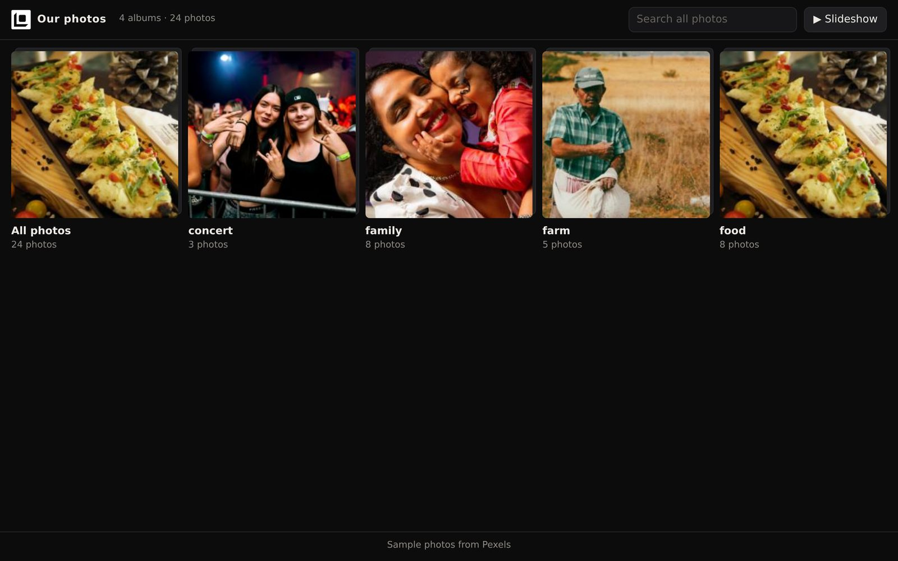
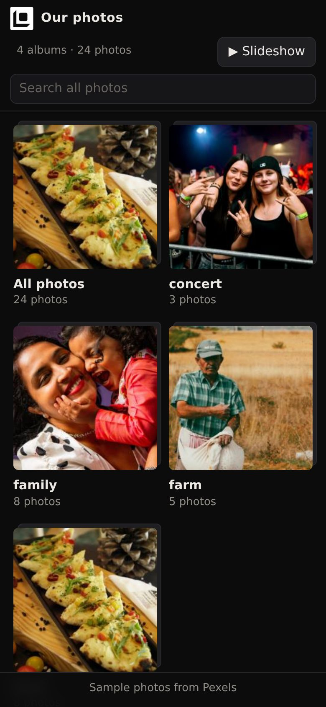
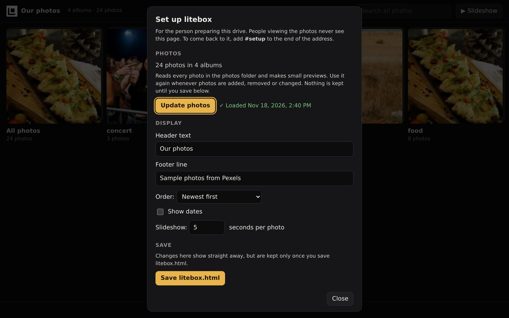
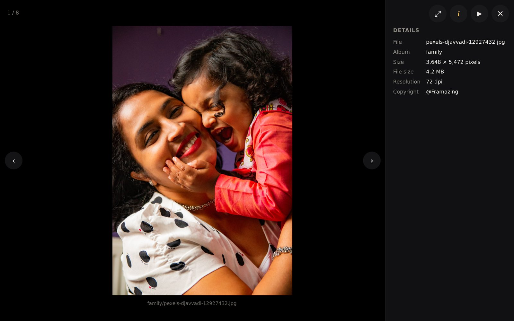

<p align="center">
  <picture>
    <source media="(prefers-color-scheme: dark)" srcset="assets/logo.png">
    
  </picture>
</p>

<h1 align="center">litebox</h1>

<p align="center">
  A photo gallery in a single file, made to sit on a thumbdrive next to your photos.
</p>

<p align="center">
  <a href="https://github.com/MapleSyrupOS/pitmaster"></a>
  <a href="https://github.com/tholent/litebox/actions/workflows/lint.yml"></a>
  <a href="https://github.com/tholent/litebox/actions/workflows/test.yml"></a>
  <a href="LICENSE"></a>
</p>

---

Put `litebox.html` and a folder of photos on a USB stick and give it to someone. They double-click the file and
see your photos in their web browser: albums, a slideshow, and the captions you wrote. There's nothing to
install, no account and no internet connection.

litebox is made for family archives, scanned slides and photo gifts: one person sets the drive up, and the
person who receives it just looks at the photos.



## What it does



- **Albums from folders.** Each folder inside `photos` becomes an album, and photos outside any folder go into
  "Unsorted".
- **A fast grid of previews**, even with thousands of photos, and a full-screen viewer with arrow keys and swipe.
- **Slideshow** with a speed slider.
- **Captions from the photos themselves.** litebox shows the description saved inside each photo (its EXIF data),
  and the date it was taken. Dates can be turned off, which helps with scans whose dates mean nothing.
- **A details panel** for each photo: camera or scanner, lens, exposure, resolution, artist, copyright.
- **Search** across descriptions, file names and album names.
- **Your order:** newest first, oldest first, or by folder and file name, which suits numbered scans.
- **Your own words:** a header text at the top, and a footer line such as "For Mum, with love, Christmas 2026".
- **Made for any modern browser, offline:** Chrome, Edge, Firefox and Safari on Windows, Mac and Linux.
- **Leaves your photos alone.** litebox only reads them. It never changes, moves or renames a photo, and never
  connects to the internet.

## Make a litebox drive

1. **Get `litebox.html`.** Open [`litebox.html`](litebox.html) here and click **Download raw file**.
2. **Lay out the drive.** Put `litebox.html` on the drive, and a folder of photos beside it. `photos` is a good
   name, but any name works, as long as the folder sits next to `litebox.html`. Each folder inside it becomes an
   album.

   ```
   your drive/
   ├── litebox.html
   └── photos/
       ├── Holiday 2024/
       ├── Grandpa's slides/
       └── IMG_0001.jpg
   ```

3. **Open `litebox.html`** in your browser and click **Set up litebox**.
4. **Click Load photos** and choose the drive (the folder that holds `litebox.html` and the photo folder), or the
   photo folder itself. If the drive has more than one folder with photos in it, litebox asks which one to show.
   litebox reads every photo and makes small previews. A big collection takes a few minutes. If the photo folder
   isn't next to `litebox.html`, setup says so.
   Your browser may ask to let the page edit files (Chrome, Edge) or to "upload" them (Firefox). Nothing leaves
   your computer: the edit permission is only used to save `litebox.html` itself, never your photos.
5. **Fill in the display settings:** the header text, the footer line, whether to show dates, and how long the
   slideshow stays on each photo. Changes show straight away.
6. **Save.**
   - In **Chrome or Edge**, click **Save litebox.html**. If the browser asks, choose the drive's folder again,
     and litebox saves itself onto the drive.
   - In **Firefox or Safari**, click **Download litebox.html**, then copy the downloaded file onto the drive,
     replacing the old one. If your Downloads folder already held a `litebox.html`, the browser may have named
     the new one `litebox (1).html` or similar: copy the newest one, and name it `litebox.html`.
7. **Hand it over.** People viewing the drive never see the setup page.



**Adding photos later:** put them in the photo folder, open `litebox.html`, add `#setup` to the end of the
address in the browser's address bar, click **Update photos**, and save again.

## Looking at the photos



| To                          | Do this                                       |
| --------------------------- | --------------------------------------------- |
| Open an album or a photo    | Click it                                      |
| Next or previous photo      | ← and → keys, or swipe                        |
| Start or pause a slideshow  | **Slideshow** button, or Space while viewing  |
| Full screen                 | **F**                                         |
| Show the photo's details    | **I**, or the **i** button                    |
| Close the photo             | **Esc**, or click the dark area around it     |

## Good to know

- **Formats:** JPEG, PNG, WebP, GIF and AVIF. litebox skips anything else (HEIC from iPhones, RAW files, videos)
  and lists what it skipped in setup. Convert HEIC photos to JPEG first if you want them included.
- **How many photos:** hundreds to a few thousand. The previews live inside `litebox.html`, about 15 KB each, so
  3,000 photos make a file of about 50 MB. Loading takes roughly a third of a second per photo on a slow computer.
- **Setup is hidden, not locked.** It keeps people from changing settings by accident. Anyone who knows to add
  `#setup` to the address, or who opens the file in a text editor, can still change it.
- **Your photos stay on the drive.** litebox has no server and sends nothing anywhere. Even the logo and the
  previews are stored inside `litebox.html`.

## For developers

litebox is plain HTML, CSS and JavaScript in one file, with no libraries and no build step. Edit `litebox.html`
and open it in a browser.

- **Tests:** `pip install -r requirements-dev.txt`, then `python3 tests/run.py`. The script builds a test drive of
  made-up photos and drives litebox through headless Chromium or Chrome. Add `--screenshots` to also save
  screenshots to `tests/out/`.
- **Lint:** `ruff check .` for Python, `npm install` then `npx eslint .` for JavaScript (including the script
  inside `litebox.html`), and `python3 tests/check-headers.py` for license headers.
- **The logo:** `assets/logo.png` is the source. `python3 assets/make-logo.py` prints the copies embedded in
  `litebox.html`.
- **The screenshots:** `python3 tests/readme-screenshots.py <drive>` loads a drive's `photos` folder into a fresh
  `litebox.html` with litebox's own code and saves the README's screenshots to `docs/images/`.

## License

litebox is licensed under the [Apache License, Version 2.0](LICENSE).

The photos in the screenshots come from [Pexels](https://www.pexels.com), free to use under the
[Pexels license](https://www.pexels.com/license/), by these Pexels contributors: aayushrawat, anthony-dalesandro, beyza-yalcin, daniel-droscher, djavvadi, filip-sestrenek, introspectivedsgn, jonathanborba, kamrujjamanjewel, krishna-kids-photography, luis-yanez, marius-gabriel, mographe, nazila, planka, rebornfilmes, safari-consoler, soldiervip, tin-stanton, vo-van-ti-n, and one unnamed contributor. They are not part
of this repository.
